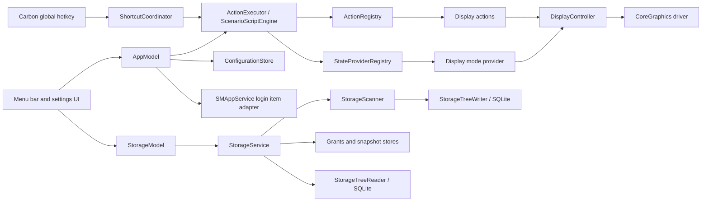

# Architecture

[Русская версия](ARCHITECTURE.ru.md)

Mac Utils separates utility definitions, macOS adapters and presentation. Scriptable actions share one execution path for UI and global hotkeys; interactive storage analysis has a dedicated model and service in those same module boundaries.

## Modules

### MacUtilsCore

`MacUtilsCore` has no AppKit, CoreGraphics, Carbon, or persistence dependency. It owns:

- `UtilityAction`, `ActionMetadata`, and typed `ActionParameter` values;
- `ActionRegistry` and the sequential `ActionExecutor`;
- `StateProvider` and `StateProviderRegistry`;
- scenarios with nested state toggles;
- visual builder domain types;
- the deliberately small DSL parser and serializer;
- scripts, global shortcut values, and persisted configuration value types;
- pure display layout planning;
- immutable storage manifests, tree descriptors/pages, canonical item references, metadata identities and size metrics;
- deterministic balanced proportional map layout.

An action is resolved only through `ActionRegistry`. A state toggle is resolved only through `StateProviderRegistry`. Both a single action and a multi-step script use the same scenario engine.

### MacUtilsSystem

`MacUtilsSystem` implements operating-system boundaries:

- `DisplayController` reads a snapshot, asks the pure `DisplayLayoutPlanner` for operations, and sends one atomic batch to `CoreGraphicsDisplayDriver`;
- display actions and the display-mode provider adapt the display controller to core contracts;
- `CarbonHotKeyRegistrar` uses native global hotkey registration;
- `ShortcutCoordinator` connects registered hotkeys to saved scenarios;
- `ConfigurationStore` validates and atomically replaces local JSON.
- `SystemLoginItemManager` maps the public `SMAppService.mainApp` registration states and operations to an injected app-facing contract.
- `StorageScanner` traverses metadata off the UI executor; `StorageService` owns scoped folder access, historical cache, revalidation, native Trash and Finder reveal.

No SwiftUI view calls these drivers directly.

### MacUtilsApp

`MacUtilsApp` is the composition and presentation layer:

- the app delegate creates the display manager, action registry, provider registry, coordinator, store, and `AppModel`;
- `AppModel` exposes observable state and routes UI intents through shared actions and scenario services;
- SwiftUI views render the menu bar popover, visual builder, shortcut editor, onboarding, and help;
- `AppText` localizes presentation by stable action/provider identifiers;
- `AppDiagnostics` contains explicit smoke commands and does not add a production execution route.
- `StorageModel` owns cancellable interactive work and stale-result rejection; `UtilityNavigation` shares the retained window's sidebar selection with the menu-bar launcher.

## Execution invariants

- The complete scenario validates before its first action runs.
- Actions execute sequentially and stop at the first failure.
- Toggle branches read current provider state on every execution.
- The DSL cannot launch processes, call a shell, read arbitrary files, or resolve names outside the registries.
- A shortcut replacement registers the candidate before releasing the prior registration.
- A failed persistence operation restores the observable model and runtime registration; a failed rollback is surfaced explicitly.
- Stored objects that cannot activate remain visible and editable rather than being dropped from the next save.
- Launch-at-login is never enabled during startup. The UI reads the system status and changes registration only after an explicit user action.

## Display configuration

CoreGraphics numeric display IDs are runtime-only. Mac Utils stores lowercase UUIDs from `CGDisplayCreateUUIDFromDisplayID` and resolves them against the current online display list before execution.

The controller serializes snapshot capture, planning, native application and readback, including across asynchronous suspension points. Changes use one `CGBeginDisplayConfiguration` / `CGCompleteDisplayConfiguration` transaction; an uncommitted transaction is cancelled on failure.

Independent display history is keyed by stable UUID and stored atomically in `display-history.json` beside `configuration.json` in Application Support. Active independent snapshots include relative geometry, logical/pixel mode dimensions, refresh rate, mode identifier and observed rotation. Reads can capture changes made in System Settings. Mirror sources and followers are excluded because their shared modes and bounds do not represent independent preferences. Failed native application does not adopt candidate history; a history-write or readback error after successful application reports that the display change already applied.

When a mirror group separates, the planner restores affected independent members, including its former source. A source that still has followers keeps the shared mode. Saved geometry is translated around the selected main display at `(0, 0)`, retaining pairwise offsets. Supported saved modes are matched by dimensions, pixel dimensions and refresh rate, with the native identifier preferred among equivalent candidates. Missing or unavailable modes use the default/native catalog fallback compatible with observed rotation. Without trustworthy geometry, a newly independent display is placed to the right. macOS can normalize unsupported gaps or overlaps.

Saved geometry requires a remembered current-main anchor so the coordinates share one reference frame. With partial history, unknown displays use planned fallback placement within that frame; if the anchor is missing, the planner retains deterministic planned geometry instead of combining unrelated coordinates. Saved mode restoration remains independent of that geometry fallback.

Rotation is observed through `CGDisplayRotation`, never changed through private APIs. A saved/current rotation mismatch rejects restoration and directs the user to macOS Displays settings. Local correlated diagnostics record snapshots, planned operations, mode selection and CoreGraphics outcomes; [Support](SUPPORT.md) explains access and diagnostic commands.

## Configuration lifecycle

`AppConfiguration` currently has schema version 1. Before v1.0.0 there is no migration layer. The store rejects unsupported or structurally invalid data and returns a safe empty value with a user-visible error. Valid data uses pretty, sorted JSON and an atomic filesystem replacement.

The App Store and direct builds use the same API. App Sandbox automatically redirects Application Support into the app container.

## Storage analysis and cleanup

Storage is an interactive utility rather than a scenario DSL action. The main-actor `StorageModel` retains usable results during replacement and rejects stale scan, page, selection and navigation completions by generation and snapshot UUID. Lightweight rows are loaded through `StorageManaging`; selected/map items resolve canonical references separately. Superseded results and closed-window readers are explicitly released. Fresh analysis synchronizes moved-folder metadata by grant ID without discarding a successful result on a separate roster-read failure. The retained AppKit window shares native sidebar/fullscreen navigation and a 960×720-point minimum. `StorageTreeView` uses `NSOutlineView`; the size map starts hidden and uses a standard resizable vertical split when enabled.

`StorageScanner` selects public `searchfs` catalog scanning for supported native APFS volume roots. `StorageCatalogVolumePlan` combines startup System/Data through official firmlink mappings and verified identities, excluding shadows and unmapped paths. `StorageCatalogScanner` reads sizes from catalog records, resolves parent contexts with `fsgetpath` and validates native leaf types/replacements without following symlinks. A bounded `getattrlistbulk` metadata cache supplements those records. Both catalog and traversal stream accepted directory/file rows into the same `StorageTreeWriter`. Full-tree rollup runs bottom-up in SQLite; the compact-only scanner retains a separate 100,000-state limit. Catalog generation, unsafe directory namespace and unrecognized final identity failures reject the run; only explicitly unsupported catalog APIs permit traversal fallback. A typed catalog-only conflict between different native leaf identities at the same verified parent/device/name retains the first accepted historical row, ID and contribution once. The incoming version contributes neither totals nor hard-link ownership. A changedDuringScan note marks that row and its ancestors incomplete. An exact-row SQLite TEMP ledger permits only those known historical leaves to skip the final leaf-identity recheck in retained overview/largest references; root and every ancestor remain checked. Directories, same-identity conflicting metadata, unknown proof mismatches and SQL failures still reject the run. Native cleanup always rechecks current identity and refuses the replacement.

Ordinary folders use iterative directory-descriptor traversal with `getattrlistbulk` where supported and no-follow metadata/child opens. Every synchronous metadata operation disables dataless materialization through the thread-scoped public I/O policy and restores the previous policy before suspension. If protection cannot be enabled, the operation fails rather than risking a cloud download. Cloud-only directories and unrelated mounted roots are excluded; the startup catalog plan includes only verified paired Data mappings. Catalog scans carry `scanMethod.volumeCatalog` and `hasUnverifiedCoverage`: zero reported errors cannot establish access to every protected resource, so `isComplete` remains false. Legacy snapshots without a method default to traversal. Progress carries traversal/catalog/validation phases, visited counts, counted bytes and an optional volume-count estimate. The UI labels the estimate approximate and caps its fraction below 100% during catalog reading.

Schema 3 stores a small validated manifest with a tree descriptor and sparse canonical IDs; its summary remains bounded to root children and largest-item references. The complete analyzed hierarchy resides in a separate SQLite index. Index format 2 masks removed subtrees with tombstones, preserving surviving IDs and the physical ID-slot count. Format-1 indices remain readable and gain mutation indices/tombstones in their first revised clone. Directories store parent identity/path context; file rows store names and parent IDs without a full relative path or ancestor array per leaf. `StorageTreeReader` reconstructs canonical paths and ancestor proofs only for requested references. Packages retain internal hierarchy and aggregate sizes; internal items are marked `isInsidePackage` and cannot be trashed separately. Up to 1,000 issue details are retained; additional issues are counted. Multiply-linked regular-file contributions are deduplicated within the physical catalog namespace or traversal root, while apparent size preserves each path's length. Memory still includes directory context caches, multiply-linked identities and expanded UI pages; it is not constant. Allocation does not prove exclusive APFS usage.

Choose Disk uses visible native mounted-volume names; `/` is shown by its volume name, with separate folder selection. Tree expansion and Show More call `treeChildren(parentID:metric:descending:offset:limit:)`, returning at most 200 rows per UI page. Siblings sort by logical/allocated size ascending or descending; sorting, page loading and map focus never invoke a source scan. Refresh scans the selected saved root, not the focused branch. Schema-1 stored trees remain readable; schema-2 compact overviews require one explicit Refresh. The largest list shows up to 200 files/whole packages from the analyzed root. Focused hierarchy maps use loaded children with up to 255 positive-size tiles and a nonselectable remainder; all indexed children remain reachable through pages. Map limits do not truncate the tree.

The service stores scoped bookmarks in Application Support `storage-grants.json` and dated summaries in `Caches/com.witqq.mac-utils/storage-snapshots.json`. The JSON archive holds at most twelve roots within 32 MiB. Adjacent private `storage-trees` contains canonical `<UUID>.sqlite` generations, `<UUID>.lease` sidecars and `.scans.lock`; directories/files use 0700/0600 with no-follow ownership checks. Replacement analysis publishes its index before the atomic manifest write; a write failure preserves the previous result and removes the unused unreturned generation. After native Trash, a revised active tree is retained even if its manifest write fails, with an explicit warning. Snapshot/grant/root/descriptor/summary binding is checked before opening a reader. A fresh schema-3 tree becomes latest even with unverified coverage; an earlier complete snapshot is retained separately. Legacy incomplete compact results preserve the previous complete latest cache. Oversized summaries can remain visible without persistence.

A soft 8 GiB tree budget evicts whole inactive generations; active/newest indices take priority. Writers check a 512 MiB free-space reserve, use batched SQLite transactions and memory journals, and abort unpublished work on failure/cancellation. Shared reader locks on `.lease` prevent deletion while a result is in use. Overlapping Service/writer shared `.scans.lock` leases protect publication handoff; cleanup requires exclusive nonblocking locks and positively verified owned UUID metadata, preserving foreign/malformed files. Clear/remove/reset and explicit `releaseTree(snapshotID:)` collect unused generations. Short archive transactions and generation checks prevent late scans from restoring cleared metadata.

Access starts/stops on the exact selected/resolved scoped URL. Stale bookmarks renew; moved folders retain grant IDs and persist their new name/path before adoption. Clear preserves grants; confirmed Reset removes storage grants/snapshots, not scanned files or automation/display history. Active readers survive cache clearing until release. The entire own tree directory, its sidecars and identity aliases are excluded from analysis with an `analysisCache` note; scanning that directory is rejected.

Localized explanations use SwiftUI help/accessibility hints and AppKit tooltips. Manage shows each metadata action and consequences beside its button; result removal/reset require confirmation. Disk Access explains Full Disk Access, the Settings route, app path and explicit retry. Opening privacy settings stops scanning without granting or probing permission. Store selection grants remain necessary. Builder menus reuse metadata through `AppText`. Finder reveal opens the first selected item; Folder in Finder opens the focused ordinary directory.

`StorageDiagnostics` writes private `storage.jsonl`/`storage.previous.jsonl` under the shared Library/Logs directory. Scan identifiers correlate preparation, scanner phase, a two-second heartbeat with last path/count/rate, validation, cache disposition, cancellation and errors. Each file is bounded to 2,000,000 bytes; oversized details are replaced by a truncation marker. Directory/file permissions are 0700/0600. Public OSLog events contain only event/scan identifiers; private paths remain in local JSONL. Trash records correlate start/completion, selected/moved/failure counts, changed paths, revision UUID and index/cache-update warnings. Logging failure does not change outcomes; injected services have no production sink by default.

A native confirmation sheet lists captured full paths with fixed Cancel/Trash controls. Before live identity/containment validation, schema-3 actions require exact canonical database membership rather than trusting the summary's ID lookup. Trash rejects package internals, scan roots, protected system trees, account/container homes and their ancestors, and the own tree-cache directory or ancestors. Account home comes from the native account record; unresolved lookup disables cleanup.

After successful native moves, `StorageTreeReader.prunedSnapshot` clones only the private SQLite index through native copy-on-write, masks successful subtrees and adjusts cached ancestor totals/child counts. A surviving hard link receives contribution ownership when its counted path is removed. The revision gets a new UUID with stable surviving IDs and preserves the original scan date, access proofs, method and coverage notes. No source scan or freshness proof is implied. Native cloning of the cache filesystem must be supported; creating metadata indices can make an older format-1 cache's first revision slower.

`StorageTrashResult.updatedSnapshot` lets the model retain expanded branches, loaded-page counts, size/order/map settings and surviving selections. A removed focus moves to its nearest surviving ancestor. The primary revision is saved; affected backups and other overlapping/unresolved grants are invalidated. Explicit narrow `scanDirectory` results remain uncached instead of replacing the wider primary root.

Before native moves, owner-only zero-byte `<UUID>.superseded` markers are fsynced for source and potentially affected stored/active generations, including legacy snapshots. Failure to persist protection refuses moves. Only newly provisional markers are rolled back when no moves succeed or their generation is unaffected by actual successes; prior markers remain. `StorageManaging.isSnapshotSuperseded` combines memory and durable markers, so a readable old JSON manifest after a write failure reopens read-only until explicit Refresh. Its list can still show objects already moved to Trash; the marker blocks further native Trash from this historical result, preventing a new mutation from reintroducing old rows into another revision. Cleanup retains both active/session generations and all latest/backup tree UUIDs from the last successfully loaded or saved disk manifest. Releasing readers after a failed write therefore preserves the readable historical index and its marker; only a successful manifest replacement changes that persisted retention set. Safe owned-index disposal removes its matching marker; legacy marker orphans are retained conservatively.

A JSON-write failure retains the accurate current-session tree with a warning; post-native prune failure preserves a historical browser, hides known moved items and blocks further Trash until Refresh. Neither warning undoes native moves. Partial item failures and cache-write errors remain separate. Public Trash is path-based, so mutation between the last check and move remains a limitation. No permanent-delete fallback or automatic global cleanup exists.

Both distributions compile the utility. The Store entitlements grant user-selected read/write access and app-scoped bookmarks; signed live sandbox selection remains unverified locally. Native management shortcuts open macOS Storage, the account's Downloads and Trash; a readable Settings route remains available when navigation fails.

## Project generation and distribution configurations

Swift Package Manager defines modules and package tests. `project.yml` reproducibly generates `MacUtils.xcodeproj` through XcodeGen 2.46.0 or later.

- `MacUtils-Direct` uses the direct-distribution entitlement file.
- `MacUtils-AppStore` enables App Sandbox.
- `MacUtils-UI` isolates the signed XCUITest runner.

Both release configurations enable Hardened Runtime and treat warnings as errors. Local archive scripts disable signing intentionally; protected release automation supplies Apple credentials.

## Verification boundaries

Pure layout, parser, executor, builder, persistence, provider, and hotkey coordination behavior use fakes in unit tests. Display-driver tests simulate shared modes and geometry on both mirror members and compare restored state. Integration tests verify shared registry/executor paths. UI-render tests instantiate actual SwiftUI surfaces in English and Russian. The explicit hardware round-trip command attempts to recover the starting roles and compares final native modes, rotation and geometry; recovery can fail and require Displays settings. On the physical Odyssey G61SD main display and portrait G27Q to its right, `--display-roundtrip` restored the original roles, coordinates, logical/pixel dimensions, refresh rates and rotation after both mirror directions. The user confirmed uncropped portrait rendering and correct right-side placement. This evidence applies to that pair and arrangement; other hardware/configurations require verification.

See [Extending Mac Utils](EXTENDING.md) for the implementation sequence and [Known limitations](KNOWN-LIMITATIONS.md) for confirmed environment constraints.

Injected display controllers do not write production diagnostics by default. Logging tests explicitly inject a sink in a disposable directory, keeping simulated display records out of the user's hardware logs.
