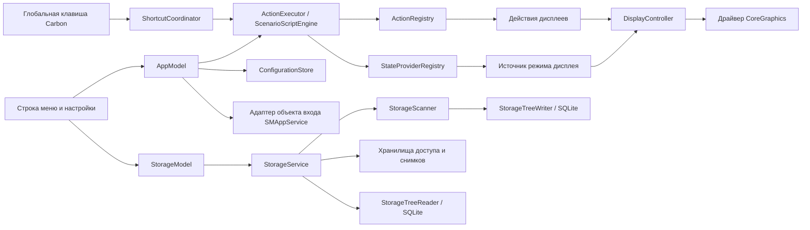

# Архитектура

[English version](ARCHITECTURE.md)

Mac Utils разделяет определения утилит, адаптеры macOS и представление. Действия сценариев используют общий путь для интерфейса и глобальных клавиш; интерактивный анализ хранилища имеет отдельные модель и сервис в тех же границах модулей.

## Модули

### MacUtilsCore

`MacUtilsCore` не зависит от AppKit, CoreGraphics, Carbon или хранилища. Модуль содержит:

- `UtilityAction`, `ActionMetadata` и типизированные `ActionParameter`;
- `ActionRegistry` и последовательный `ActionExecutor`;
- `StateProvider` и `StateProviderRegistry`;
- сценарии с вложенными переключениями по состоянию;
- доменные типы визуального конструктора;
- небольшой безопасный DSL, его parser и serializer;
- значения сценариев, горячих клавиш и сохраняемой конфигурации;
- чистое планирование схемы дисплеев;
- неизменяемые краткие снимки хранилища, дескрипторы/страницы дерева, канонические ссылки, идентичность метаданных и виды размера;
- детерминированную сбалансированную пропорциональную раскладку карты.

Действие разрешается только через `ActionRegistry`, а источник состояния — только через `StateProviderRegistry`. Одно действие и многошаговый сценарий используют один движок.

### MacUtilsSystem

`MacUtilsSystem` реализует границы операционной системы:

- `DisplayController` читает снимок, получает операции от чистого `DisplayLayoutPlanner` и отправляет один атомарный пакет в `CoreGraphicsDisplayDriver`;
- действия и источник режима дисплея адаптируют контроллер к контрактам ядра;
- `CarbonHotKeyRegistrar` регистрирует нативные глобальные сочетания;
- `ShortcutCoordinator` связывает клавиши с сохранёнными сценариями;
- `ConfigurationStore` проверяет и атомарно заменяет локальный JSON.
- `SystemLoginItemManager` преобразует состояния и операции публичного `SMAppService.mainApp` в инъецируемый контракт приложения.
- `StorageScanner` обходит метаданные вне исполнителя UI; `StorageService` управляет ограниченным доступом к папкам, историческим кешем, повторной проверкой, нативной Корзиной и показом в Finder.

SwiftUI-представления не вызывают системные драйверы напрямую.

### MacUtilsApp

`MacUtilsApp` — слой композиции и представления:

- app delegate создаёт менеджер дисплеев, реестры, coordinator, store и `AppModel`;
- `AppModel` публикует наблюдаемое состояние и направляет намерения UI через общие действия и сценарии;
- SwiftUI показывает строку меню, конструктор, редактор клавиш, знакомство и справку;
- `AppText` локализует представление по стабильным идентификаторам действий и источников;
- `AppDiagnostics` содержит явные smoke-команды и не создаёт дополнительный production-путь выполнения.
- `StorageModel` управляет отменяемой интерактивной работой и отклоняет устаревшие результаты; `UtilityNavigation` связывает выбор боковой панели сохранённого окна с запуском из строки меню.

## Инварианты выполнения

- Весь сценарий проверяется до запуска первого действия.
- Действия выполняются последовательно и останавливаются на первой ошибке.
- Переключение читает текущее состояние при каждом запуске.
- DSL не запускает процессы или shell, не читает произвольные файлы и не разрешает имена вне реестров.
- При замене горячей клавиши сначала регистрируется кандидат, затем снимается прежнее назначение.
- При ошибке записи восстанавливаются модель и runtime-регистрация; ошибка самого восстановления показывается явно.
- Неактивируемые сохранённые объекты остаются видимыми и доступными для исправления.
- Автозапуск никогда не включается при старте приложения. Интерфейс читает системное состояние и меняет регистрацию только после явного действия пользователя.

## Конфигурация дисплеев

Числовые идентификаторы CoreGraphics существуют только во время работы. Mac Utils сохраняет UUID из `CGDisplayCreateUUIDFromDisplayID` в нижнем регистре и перед выполнением разрешает его по текущему списку online-дисплеев.

Контроллер последовательно выполняет чтение снимка, планирование, применение и чтение фактического результата, в том числе через асинхронные приостановки. Изменения используют одну транзакцию `CGBeginDisplayConfiguration` / `CGCompleteDisplayConfiguration`; незавершённая транзакция отменяется при ошибке.

История независимых дисплеев привязана к стабильным UUID и атомарно хранится в `display-history.json` рядом с `configuration.json` в Application Support. Снимки активных независимых дисплеев содержат относительную геометрию, логические и пиксельные размеры режима, частоту обновления, идентификатор режима и наблюдаемый поворот. Чтение может запоминать изменения из Системных настроек. Источники зеркала и их последователи исключаются: общие режимы и границы не отражают независимые предпочтения. При неудачном применении история-кандидат не принимается; ошибка записи истории или чтения после успешного применения сообщает, что схема дисплеев уже изменена.

При разделении зеркальной группы планировщик восстанавливает затронутых независимых участников, включая бывший источник. Источник с оставшимися последователями сохраняет общий режим. Сохранённая геометрия переносится относительно выбранного основного дисплея в `(0, 0)`, сохраняя взаимные смещения. Поддерживаемый сохранённый режим подбирается по логическим и пиксельным размерам и частоте; среди эквивалентных вариантов предпочтителен прежний нативный идентификатор. Если режим неизвестен или недоступен, используется режим по умолчанию либо собственный режим панели, совместимый с наблюдаемым поворотом. Без достоверной геометрии вновь независимый дисплей размещается справа. macOS может нормализовать неподдерживаемые зазоры и перекрытия.

Сохранённая геометрия требует запомненного положения текущего основного дисплея, чтобы координаты имели общую точку отсчёта. При частичной истории неизвестные дисплеи получают предусмотренное резервное положение в той же системе координат; если положение основного дисплея неизвестно, планировщик сохраняет детерминированную запланированную геометрию вместо смешивания несвязанных координат. Восстановление сохранённых режимов не зависит от этого резервного размещения.

Поворот читается через `CGDisplayRotation` и не меняется через приватные API. Несовпадение сохранённого и фактического поворота отклоняет восстановление и направляет пользователя в настройки дисплеев macOS. Локальная диагностика связывает снимки, план операций, выбор режимов и результаты CoreGraphics; доступ и команды описаны в [Поддержке](SUPPORT.ru.md).

## Жизненный цикл конфигурации

Текущая версия схемы `AppConfiguration` — 1. До v1.0.0 миграционного слоя нет. Store отклоняет неподдерживаемые или структурно некорректные данные и возвращает безопасное пустое значение с видимой ошибкой. Корректная конфигурация записывается как отсортированный JSON с атомарной заменой файла.

Store- и direct-сборки используют один API. App Sandbox автоматически направляет Application Support в контейнер приложения.

## Анализ и очистка хранилища

Хранилище — интерактивная утилита, а не действие DSL. Модель `StorageModel` на главном акторе сохраняет результат во время замены и отклоняет устаревшие результаты анализа, страниц, выбора и навигации по поколению и UUID снимка. Лёгкие строки приходят через `StorageManaging`; ссылки выбранных объектов/карты разрешаются отдельно. Заменённые результаты и читатели закрытого окна явно освобождаются. Новый анализ обновляет метаданные перемещённой папки по ID доступа без потери успешного результата при отдельной ошибке списка расположений. Общее окно AppKit использует нативную боковую навигацию/полноэкранный режим и минимум 960×720 пунктов. `StorageTreeView` построен на `NSOutlineView`; карта изначально скрыта, при включении используется стандартный изменяемый вертикальный разделитель.

`StorageScanner` выбирает публичный `searchfs` для поддерживаемых нативных корней APFS. `StorageCatalogVolumePlan` объединяет System/Data по официальным firmlink и проверенным идентичностям, исключая дубли и несопоставленные пути. `StorageCatalogScanner` читает размеры записей каталога, разрешает контекст родителей через `fsgetpath` и проверяет типы/замены без перехода по ссылкам. Ограниченный кеш `getattrlistbulk` дополняет метаданные. Каталог и обход направляют принятые строки папок/файлов в общий `StorageTreeWriter`. Полные итоги дерева вычисляются снизу вверх в SQLite; отдельный компактный режим сохраняет предел 100 000 состояний. Изменение поколения, небезопасные пути папок и неизвестное несовпадение итоговой идентичности отклоняют анализ; только явно неподдерживаемый API разрешает переход к обходу. Типизированный конфликт каталога между разными нативными идентичностями объекта по одному имени у проверенного родителя/устройства сохраняет первую принятую историческую строку, ID и вклад один раз. Новая версия не добавляет итоги и не получает учёт жёсткой ссылки. Замечание changedDuringScan отмечает строку и её родителей неполными. Точный список строк в SQLite TEMP разрешает только таким известным историческим объектам пропустить итоговую проверку идентичности самого объекта в обзоре/крупнейших; корень и каждый родитель проверяются по-прежнему. Папки, противоречивые метаданные при прежней идентичности, неизвестные несовпадения доказательств и ошибки SQL отклоняют анализ. Нативная очистка всегда проверяет текущую идентичность и отказывает для заменённого объекта.

Обычные папки анализируются итеративным обходом дескрипторов с `getattrlistbulk`, где он поддерживается, и чтением метаданных/открытием детей без перехода по ссылкам. Каждая синхронная операция запрещает загрузку облачных объектов публичной политикой ввода-вывода рабочего потока и восстанавливает прежнюю политику до асинхронной приостановки. Если защита не включилась, операция завершается ошибкой. Облачные папки и посторонние подключённые корни исключаются; план загрузочного каталога включает только проверенные соответствия парного Data. Результат каталога содержит `scanMethod.volumeCatalog` и `hasUnverifiedCoverage`: отсутствие сообщённых ошибок не доказывает доступ ко всем защищённым объектам, поэтому `isComplete` остаётся ложным. Старые снимки без способа анализа по умолчанию считаются результатами обхода. Прогресс передаёт этап обхода/каталога/проверки, число объектов, учтённые размеры и необязательную оценку по числу объектов тома. Интерфейс помечает оценку как приблизительную и не показывает 100% во время чтения каталога.

Схема 3 хранит краткий проверенный снимок с дескриптором дерева и разреженными каноническими ID; обзор ограничен детьми корня и крупнейшими объектами. Полная проанализированная иерархия хранится в отдельном SQLite. Формат индекса 2 скрывает перенесённые поддеревья отметками tombstone, сохраняя ID оставшихся объектов и число физических слотов ID. Формат 1 читается и получает индексы метаданных/отметки в первой изменённой копии. Папки сохраняют контекст родителей/путей; строки файлов — имена и ID родителей без полного относительного пути и массива родителей на каждый файл. `StorageTreeReader` восстанавливает канонический путь и доказательства родителей только для запрошенной ссылки. Пакеты сохраняют внутреннюю иерархию и суммарные размеры; внутренние объекты отмечены `isInsidePackage` и не переносятся в Корзину отдельно. Сохраняются до 1 000 подробностей замечаний, остальные считаются. Вклады обычных файлов с несколькими ссылками учитываются один раз в физическом каталоге или корне обхода, apparent size сохраняет длину каждого пути. Память также зависит от кешей контекстов, идентичностей жёстких ссылок и раскрытых страниц UI; она не постоянна. Сумма выделенных блоков не доказывает исключительную занятость APFS.

Выбор диска показывает видимые нативные имена томов; `/` показан именем тома, выбор папки отдельный. Раскрытие и «Показать ещё» вызывают `treeChildren(parentID:metric:descending:offset:limit:)`: UI загружает до 200 строк за страницу. Соседние объекты сортируются по логическому размеру/размеру на диске в обе стороны; сортировка, страницы и фокус карты не запускают анализ исходных файлов. Обновление анализирует выбранный сохранённый корень, а не ветвь фокуса. Деревья схемы 1 читаются; компактный обзор схемы 2 требует один явный запуск обновления. Список крупных объектов показывает до 200 файлов/целых пакетов из корня анализа. Карта выбранной папки использует загруженных детей: до 255 ненулевых блоков и недоступную для выбора сумму остальных. Все дети индекса доступны через страницы; предел карты не обрезает дерево.

Сервис хранит закладки в Application Support `storage-grants.json`, датированные краткие снимки — в `Caches/com.witqq.mac-utils/storage-snapshots.json`. JSON удерживает до двенадцати корней в пределах 32 МиБ. Соседний приватный `storage-trees` содержит канонические поколения `<UUID>.sqlite`, файлы блокировок `<UUID>.lease` и `.scans.lock`; права каталогов/файлов 0700/0600 проверяются без перехода по ссылкам и до изменения прав. Новый анализ публикует индекс перед атомарной записью снимка; ошибка записи сохраняет прежний результат и удаляет неиспользуемое невыданное поколение. После нативной Корзины обновлённое активное дерево остаётся доступным и при ошибке записи снимка, с явным предупреждением. Читатель проверяет привязку снимка, доступа, корня, дескриптора и обзора. Новое дерево схемы 3 становится последним результатом и при неподтверждённой полноте; прежний полный снимок сохраняется отдельно. Старый неполный компактный результат сохраняет прежний полный последний кеш. Слишком большой краткий снимок может показываться без сохранения.

Мягкий бюджет дерева 8 ГиБ вытесняет целые неактивные поколения; активные/последний индекс имеют приоритет. Запись проверяет резерв 512 МиБ свободного места, использует пакетные транзакции SQLite и журналы в памяти; ошибка/отмена удаляет неопубликованную работу. Общие блокировки читателей на `.lease` не дают удалить используемый результат. Перекрывающиеся общие блокировки `.scans.lock` сервиса/писателя защищают передачу поколения; очистка требует исключительных неблокирующих блокировок и положительной проверки принадлежности UUID. Чужие/некорректные файлы сохраняются. Очистка/удаление/сброс метаданных и явный `releaseTree(snapshotID:)` удаляют неиспользуемые поколения. Короткие транзакции и проверки поколения не дают позднему анализу воскресить сброшенный кеш.

Доступ начинается/завершается на том же выбранном/разрешённом URL. Устаревшие закладки обновляются; перемещённая папка сохраняет ID, новое имя/путь записываются до принятия. Очистка сохраняет доступ; подтверждённый сброс удаляет закладки/снимки, а не исходные файлы или историю автоматизаций/дисплеев. Активные читатели переживают очистку до освобождения. Весь собственный каталог дерева, служебные файлы и совпадающие по идентичности пути исключены с замечанием `analysisCache`; анализ самого каталога отклоняется.

Локализованные пояснения используют help/accessibility hints SwiftUI и tooltips AppKit. «Управление» показывает последствия рядом с каждой кнопкой; удаление результатов/сброс требуют подтверждения. «Доступ к диску» объясняет полный доступ, путь настроек/приложения и повторный анализ. Переход в настройки останавливает анализ, не выдаёт разрешение и не проверяет его чтением личных файлов. Выбор папки в Store обязателен. Меню конструктора переиспользуют метаданные через `AppText`. Finder показывает первый выбранный объект; «Папка в Finder» открывает обычный каталог фокуса.

`StorageDiagnostics` пишет приватные `storage.jsonl`/`storage.previous.jsonl` в общем каталоге Library/Logs. Идентификатор анализа связывает подготовку, этап сканирования, запись каждые две секунды с последним путём/числом/скоростью, проверку, решение о кеше, отмену и ошибки. Каждый файл ограничен 2 000 000 байтами; слишком большие подробности заменяются признаком сокращения. Права каталога/файлов — 0700/0600. Общедоступные события OSLog содержат только вид события и идентификатор анализа; приватные пути остаются в локальном JSONL. События Корзины связывают начало/завершение, число выбранных/перенесённых/ошибочных объектов, пути, UUID редакции и ошибки обновления индекса/кеша. Ошибка журнала не меняет результат; подставленные сервисы по умолчанию не пишут рабочие журналы.

Нативное подтверждение показывает захваченные полные пути с фиксированными кнопками отмены/Корзины. Перед проверкой текущей идентичности и границ действия схемы 3 требуют точного соответствия канонической записи базы, а не доверяют поиску ID краткого обзора. Корзина отклоняет внутренние объекты пакетов, корни анализа, защищённые системные деревья, дома аккаунта/контейнера с их родителями и собственный каталог кеша с его родителями. Дом аккаунта читается из нативной записи; при невозможности определить его очистка отключается.

После нативного переноса `StorageTreeReader.prunedSnapshot` клонирует только приватный SQLite штатным copy-on-write: скрывает успешно перенесённые поддеревья и корректирует сохранённые итоги/число детей родителей. Если учтённый путь жёсткой ссылки исчез, вклад получает оставшаяся ссылка. Редакция получает новый UUID с прежними ID оставшихся строк, сохраняет дату, доказательства доступа, способ и замечания полноты; нового анализа исходных файлов и доказательства актуальности нет. Файловая система кеша должна поддерживать нативное клонирование; первая редакция старого формата 1 может требовать времени на создание индексов метаданных.

`StorageTrashResult.updatedSnapshot` позволяет сохранить раскрытые ветви, число загруженных страниц, вид размера/порядок/карту и оставшийся выбор. Удалённый фокус переходит к ближайшему сохранившемуся родителю. Основная редакция сохраняется, затронутые резервные копии и другие пересекающиеся/неразрешённые расположения сбрасываются. Узкий явный результат `scanDirectory` остаётся без кеша и не подменяет широкий корень.

До переноса записываются и синхронизируются нулевые приватные `<UUID>.superseded` для исходного и потенциально затронутых сохранённых/активных поколений, включая старые схемы. Ошибка записи защиты отклоняет перенос. Удаляются только новые предварительные отметки при отсутствии успехов или если реальный успех не затронул их поколение; прежние отметки сохраняются. `StorageManaging.isSnapshotSuperseded` объединяет память и сохранённые отметки: читаемый прежний JSON после ошибки записи открывается только для просмотра до явного обновления. Его список может по-прежнему содержать уже перенесённые объекты; отметка запрещает дальнейшую нативную Корзину из этого исторического результата, чтобы новая редакция не включила старые строки повторно. Очистка сохраняет активные поколения/результаты сессии и UUID последних/резервных деревьев из последнего успешно загруженного или записанного файла снимков. Поэтому освобождение читателей после ошибки записи сохраняет читаемый исторический индекс и отметку; набор сохранённых UUID меняется только после успешной замены файла. Безопасное удаление принадлежащего приложению индекса убирает его отметку; отдельные отметки старых схем сохраняются консервативно.

Ошибка JSON сохраняет точное дерево текущей сессии с предупреждением; ошибка индекса после переноса оставляет исторический просмотр, скрывает известные перенесённые объекты и блокирует Корзину до обновления. Предупреждения не отменяют перенос. Частичные ошибки и ошибки кеша показываются отдельно. Корзина принимает путь, поэтому одновременное изменение между проверкой и переносом остаётся ограничением. Постоянного удаления вместо Корзины и автоматической глобальной очистки нет.

Утилита компилируется в обоих вариантах распространения. Store entitlements разрешают чтение/запись выбранных пользователем папок и закладки приложения; нативный выбор в подписанной песочнице локально ещё не проверен. Системные кнопки открывают хранилище macOS, Загрузки и Корзину аккаунта; если переход не сработал, остаётся понятный маршрут в Системных настройках.

## Генерация проекта и варианты распространения

Swift Package Manager определяет модули и package-тесты. `project.yml` воспроизводимо генерирует `MacUtils.xcodeproj` через XcodeGen 2.46.0 или новее.

- `MacUtils-Direct` использует entitlements прямого распространения.
- `MacUtils-AppStore` включает App Sandbox.
- `MacUtils-UI` изолирует подписываемый XCUITest runner.

Обе release-конфигурации включают Hardened Runtime и считают предупреждения ошибками. Локальные архивы намеренно не подписываются; Apple credentials добавляет защищённый релизный процесс.

## Границы проверки

Планирование, parser, executor, builder, store, providers и координация клавиш проверяются unit-тестами с fake-реализациями. Тесты драйвера моделируют общий режим и геометрию обоих участников зеркала и сравнивают восстановленное состояние. Интеграционные тесты проверяют общий путь registry/executor. UI-render тесты создают реальные SwiftUI-экраны на русском и английском. Явная аппаратная команда полного цикла пытается вернуть исходные роли и сравнивает конечные нативные режимы, поворот и геометрию; восстановление может потребовать настроек дисплеев. На физической паре с основным Odyssey G61SD и вертикальным G27Q справа команда `--display-roundtrip` вернула исходные роли, координаты, логические/пиксельные размеры, частоты и поворот после обоих направлений зеркала. Пользователь подтвердил изображение без обрезания и правильное положение справа. Это свидетельство относится к данной паре и раскладке; другое оборудование и конфигурации требуют проверки.

Последовательность добавления функции описана в [Расширении Mac Utils](EXTENDING.ru.md), ограничения — в [Известных ограничениях](KNOWN_LIMITATIONS.ru.md).

Контроллеры с подставленным драйвером по умолчанию не пишут в пользовательскую диагностику. Тесты журналирования явно получают приёмник в удаляемом временном каталоге, поэтому моделируемые дисплеи не попадают в аппаратные журналы пользователя.
